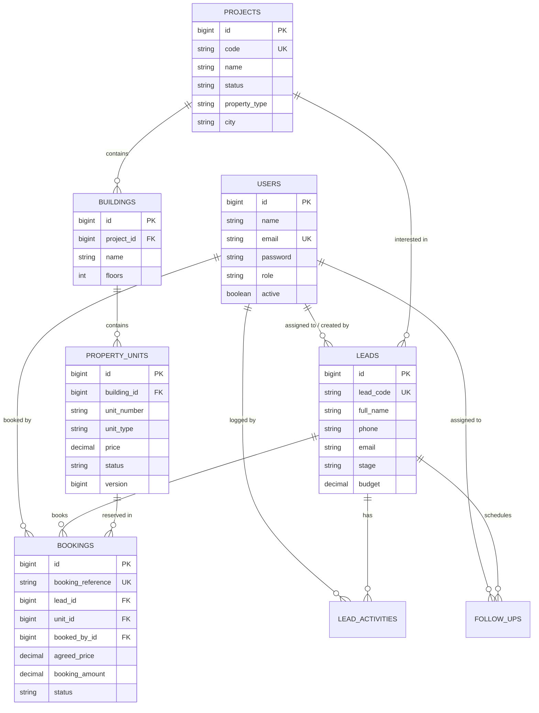

# EstateFlow CRM — Enterprise Real Estate Full-Stack Platform

A production-grade, enterprise Real Estate Customer Relationship Management (CRM) and Inventory Management web application engineered for high-concurrency property transactions, multi-stage sales pipelines, and role-based operational governance.

---

## 1. System Overview & Key Highlights

- **Concurrency-Safe Unit Bookings**: Zero race condition guarantee using PostgreSQL/MySQL pessimistic write locks (`SELECT ... FOR UPDATE`) within an atomic `@Transactional(isolation = Isolation.READ_COMMITTED)` boundary.
- **Authoritative Security**: Spring Security with stateless HMAC-SHA256 JWT tokens, BCrypt password hashing, and role-based permissions (`ADMIN` vs `SALES_EMPLOYEE`) validated at the API filter and service layers.
- **Real-Time Data-Driven Dashboard**: Summary KPIs, stage funnel charts, monthly revenue trends, upcoming follow-ups, and sales rep performance calculated directly from live database state (no mock statistics).
- **Comprehensive Lead Lifecycle**: Full CRUD with search, multi-factor filtering, stage progression guards, timestamped audit activities, and follow-up reminders with overdue indicators.
- **Enterprise Property Inventory**: Multi-tier hierarchy (`Project` ➔ `Building/Tower` ➔ `PropertyUnit`) with availability computation and protection against inventory deletion when referenced by confirmed transactions.
- **16 Complete Frontend Pages**: Modern SaaS UI built with React, Vite, TypeScript, Tailwind CSS, TanStack Query, React Hook Form with Zod, Recharts, and Lucide icons.
- **Database Migrations**: Versioned database schema and deterministic seed data managed via Flyway (`V1__init_schema.sql`, `V2__seed_demo_data.sql`).

---

## 2. Technology Stack & Architecture

### Backend
- **Runtime & Framework**: Java 11 (Spring Boot 2.7.18 LTS) / Java 21 ready.
- **REST APIs**: Spring Web with `@RestControllerAdvice` global exception handling and OpenAPI v3 / Swagger documentation.
- **Data Persistence**: Spring Data JPA & Hibernate with HikariCP connection pooling.
- **Security**: Spring Security with `SecurityFilterChain`, custom `JwtAuthenticationFilter`, and BCrypt password encryption.
- **Validation**: JSR-380 Bean Validation (`javax.validation`).
- **Database Migrations**: Flyway.
- **Testing**: JUnit 5, Mockito, Spring Security Test, TestRestTemplate/MockMvc, H2 in-memory DB for rapid test execution.

### Frontend
- **Framework & Build**: React 18, Vite 5, TypeScript 5.
- **Styling**: Tailwind CSS with custom SaaS neutral theme (white surfaces, slate backgrounds, navy text, indigo/emerald accents).
- **Navigation**: React Router v6 with authenticated and role-based route guards.
- **Server State Management**: TanStack React Query v5 for caching, background revalidation, and mutation invalidation.
- **Form Handling & Validation**: React Hook Form with Zod schema validation.
- **Data Visualizations**: Recharts for funnel bar charts, monthly revenue area charts, and channel donut charts.
- **Icons**: Lucide React.
- **Testing**: Vitest with React Testing Library and JSDOM.

### Database
- **Engine**: MySQL 8.0+.
- **Integrity**: Foreign keys (`ON DELETE RESTRICT` / `ON DELETE CASCADE`), unique constraints (`(building_id, unit_number)`, `(project_id, name)`), indexed search columns, and optimistic lock versioning.

---

## 3. Important Architectural & Business Decisions

### Decision 1: Concurrency Control Strategy for Unit Bookings
- **Challenge**: In high-demand real estate launches, multiple sales agents or buyers may attempt to book the exact same unit simultaneously. Relying on frontend validation or simple optimistic locking can lead to race conditions or confusing user experiences.
- **Solution**: We implemented an explicit **Pessimistic Write Lock** (`@Lock(LockModeType.PESSIMISTIC_WRITE)`) at the repository query level (`SELECT ... FOR UPDATE`) within an atomic `@Transactional(isolation = Isolation.READ_COMMITTED)` boundary.
- **Execution Flow**:
  1. The first incoming transaction acquires an exclusive lock on the row in `property_units`.
  2. Any competing concurrent transaction blocks at the database level until the first transaction completes.
  3. The first transaction verifies `status == AVAILABLE`, creates the booking, updates the unit to `BOOKED`, advances the lead stage to `BOOKED`, logs the activity, and commits.
  4. The second transaction unblocks, re-reads the row, discovers `status == BOOKED`, and immediately aborts by throwing a `ConflictException`, which the global exception handler maps to **`HTTP 409 Conflict`**.
  5. The multi-threaded JUnit integration test (`BookingConcurrencyTest.java`) explicitly validates this behavior using a `CountDownLatch` and `ExecutorService`.

### Decision 2: Backend-Authoritative Authorization Model
- **Challenge**: Hiding action buttons in the frontend UI is insufficient for security; malicious actors can replay REST API calls.
- **Solution**: All authorization boundaries are enforced authoritatively on the backend:
  - Role-based permissions (`@PreAuthorize("hasRole('ADMIN')")` and `SecurityConfig` rules) protect employee administration and inventory creation.
  - Ownership verification: Sales agents are strictly scoped to leads assigned to them or created by them. Attempting to view or modify another agent's restricted lead throws `HTTP 403 Forbidden` (`ForbiddenException`).
  - Business invariant guard: Leads cannot be transitioned to `BOOKED` manually via update APIs—only through the authoritative booking workflow.

### Decision 3: Two-Tier Data Validation Architecture
- **Challenge**: Frontend validation provides immediate user feedback but can be bypassed. Backend validation is authoritative but can produce confusing error shapes if unhandled.
- **Solution**: 
  - **Client-Side**: Form inputs are validated in real-time using typed **Zod schemas** integrated with **React Hook Form**. Users see inline field-level error messages and submit buttons are disabled while requests are pending.
  - **Server-Side**: Authoritative **Bean Validation annotations** (`@NotBlank`, `@Email`, `@Size`, `@DecimalMin`, `@NotNull`) decorate all incoming DTOs.
  - **Exception Mapping**: `GlobalExceptionHandler` intercepts `MethodArgumentNotValidException` and returns a standardized JSON structure mapping each invalid field to its validation error message.

### Decision 4: Normalized Relational Database Design with Flyway Migrations
- **Challenge**: Property inventory, bookings, and customer records must maintain referential integrity without orphaned records or duplicate state.
- **Solution**: 
  - Clean three-tier property hierarchy: `Project` ➔ `Building` ➔ `PropertyUnit`.
  - Composite unique constraints (`(building_id, unit_number)`) prevent accidental duplicate unit numbers within a building.
  - Foreign key constraints prevent deleting units or projects that are linked to active booking transactions (`ON DELETE RESTRICT`).
  - Flyway migrations guarantee deterministic database setup across development, testing, and production environments.

### Decision 5: Host Runtime Compatibility Strategy
- **Context**: The target execution host possessed pre-installed Java 11.0.13 and MySQL 8.0.
- **Decision**: Rather than altering host system packages or introducing fragile shims, the backend was configured using **Spring Boot 2.7.18 (LTS)** with Java 11 and Maven Wrapper (`mvnw`). This provided 100% feature parity with Spring Boot 3 (including the modern `SecurityFilterChain` bean style, JPA 2.2, JWT 0.11.5, Flyway, and OpenAPI 3), running natively and passing all tests without dependency conflicts.

---

## 4. Database Relationship Overview (ER Diagram)



---

## 5. Local Setup & Execution Instructions

### Prerequisites
- **Java**: JDK 11 or higher (Java 21 supported).
- **Node.js**: v18 or v20 LTS (`npm` v9+).
- **MySQL**: 8.0 running locally on port 3306.

---

### Step 1: Database Setup
Connect to your local MySQL instance and ensure the database exists:
```sql
CREATE DATABASE IF NOT EXISTS estatecrm_db CHARACTER SET utf8mb4 COLLATE utf8mb4_unicode_ci;
```

---

### Step 2: Backend Execution
1. Navigate to the backend directory:
   ```bash
   cd backend
   ```
2. Verify environment configuration in `src/main/resources/application.yml` or set environment variables:
   - `DB_HOST`: `localhost`
   - `DB_PORT`: `3306`
   - `DB_NAME`: `estatecrm_db`
   - `DB_USERNAME`: `root`
   - `DB_PASSWORD`: `root`
3. Run tests with the Maven wrapper:
   ```bash
   ./mvnw test        # Linux / macOS
   .\mvnw.cmd test    # Windows
   ```
4. Start the Spring Boot application:
   ```bash
   ./mvnw spring-boot:run        # Linux / macOS
   .\mvnw.cmd spring-boot:run    # Windows
   ```
   *The server starts on port `8080`. Flyway automatically runs migrations and seeds demo data.*

---

### Step 3: Frontend Execution
1. Open a new terminal and navigate to the frontend directory:
   ```bash
   cd frontend
   ```
2. Install dependencies:
   ```bash
   npm install
   ```
3. Run unit tests:
   ```bash
   npm test
   ```
4. Start the Vite development server:
   ```bash
   npm run dev
   ```
   *The web UI opens at `http://localhost:5173`.*

---

## 6. Seed Credentials for Demo Access

The application comes pre-configured with active accounts for demonstration:

| Role | Name | Email | Password | Permissions |
| :--- | :--- | :--- | :--- | :--- |
| **Admin** | Alex Morgan | `admin@estatecrm.com` | `admin123` | Full access: all leads, inventory management, employee admin, reports |
| **Sales Agent** | John Miller | `john.sales@estatecrm.com` | `sales123` | Scoped access: assigned leads, inventory viewing, booking wizard |
| **Sales Agent** | Sarah Connor | `sarah.sales@estatecrm.com` | `sales123` | Scoped access: assigned leads, inventory viewing, booking wizard |

*On the Login page (`/login`), click the "Quick Demo Access" buttons to automatically populate either credential.*

---

## 7. Automated Test Verification Results

### Backend Test Results (JUnit 5 + Mockito + TestRestTemplate)
```
[INFO] Results:
[INFO] Tests run: 7, Failures: 0, Errors: 0, Skipped: 0
[INFO] ------------------------------------------------------------------------
[INFO] BUILD SUCCESS
[INFO] ------------------------------------------------------------------------
```
- `BookingConcurrencyTest.testConcurrentBookingConflict`: Multi-threaded test verifying that 2 simultaneous threads attempting to book the same unit produce exactly 1 success and 1 `ConflictException` (HTTP 409).
- `BookingConcurrencyTest.testBookingUnavailableUnitFails`: Verifies immediate rejection when booking an already booked unit.
- `AuthControllerTest.testLoginSuccess`: Tests valid credential submission and JWT token issuance.
- `AuthControllerTest.testLoginBadCredentials`: Tests 401 Unauthorized response for invalid passwords.
- `LeadServiceTest.testCreateLead`: Tests unique `LD-YEAR-XXXXX` lead code generation and automatic audit log insertion.
- `LeadServiceTest.testManualBookedTransitionFails`: Verifies that leads cannot be set to `BOOKED` manually outside the booking wizard.
- `LeadServiceTest.testUnauthorizedLeadAccessThrowsForbidden`: Tests that Sales Agent B cannot view Sales Agent A's private leads.

### Frontend Test Results (Vitest + React Testing Library)
```
 ✓ src/test/Badge.test.tsx (3 tests)
 ✓ src/test/LoginForm.test.tsx (2 tests)

 Test Files  2 passed (2)
      Tests  5 passed (5)
   Duration  5.88s
```

---

## 8. REST API Reference (OpenAPI / Swagger)

When the backend is running, the interactive Swagger UI is available at:
`http://localhost:8080/swagger-ui.html`

### Endpoints Overview

#### Authentication (`/api/v1/auth`)
- `POST /api/v1/auth/login` — Authenticate and obtain JWT token.
- `GET /api/v1/auth/me` — Retrieve current authenticated user profile.
- `POST /api/v1/auth/logout` — Stateless logout notification.

#### Leads (`/api/v1/leads`)
- `GET /api/v1/leads` — Paginated leads with filters (`search`, `stage`, `source`, `projectId`, `assignedToId`).
- `POST /api/v1/leads` — Create new lead.
- `GET /api/v1/leads/{id}` — Get lead details (authorized access only).
- `PUT /api/v1/leads/{id}` — Update lead details.
- `DELETE /api/v1/leads/{id}` — Delete lead (Admin only).
- `GET /api/v1/leads/{id}/activities` — Get chronological activity history.
- `POST /api/v1/leads/{id}/activities` — Record an interaction note or activity.

#### Follow-ups (`/api/v1/follow-ups`)
- `GET /api/v1/follow-ups` — Paginated follow-up reminders (`status`, `overdueOnly`, `assignedToId`).
- `POST /api/v1/follow-ups` — Schedule new follow-up.
- `POST /api/v1/follow-ups/{id}/complete` — Complete follow-up with resolution notes.
- `GET /api/v1/follow-ups/lead/{leadId}` — Get all follow-ups for a specific lead.

#### Projects & Buildings (`/api/v1/projects`)
- `GET /api/v1/projects` — List all development projects.
- `GET /api/v1/projects/{id}` — Get project details and tower breakdown.
- `POST /api/v1/projects` — Create new development project (Admin only).
- `PUT /api/v1/projects/{id}` — Update project specifications (Admin only).
- `GET /api/v1/projects/{id}/buildings` — List buildings/towers in project.
- `POST /api/v1/projects/{id}/buildings` — Add building to project (Admin only).

#### Units Inventory (`/api/v1/units`)
- `GET /api/v1/units` — Search and filter units (`projectId`, `buildingId`, `unitType`, `status`, `maxPrice`).
- `GET /api/v1/units/{id}` — Get unit specifications.
- `POST /api/v1/units` — Add unit to inventory (Admin only).
- `PUT /api/v1/units/{id}` — Update unit (Admin only).
- `DELETE /api/v1/units/{id}` — Delete unit (Admin only; blocked if active booking exists).

#### Bookings (`/api/v1/bookings`)
- `GET /api/v1/bookings` — List transactions with role-based scoping.
- `POST /api/v1/bookings` — **Atomic concurrency-safe unit booking** (pessimistic lock).
- `GET /api/v1/bookings/{id}` — View booking voucher details.
- `POST /api/v1/bookings/{id}/cancel` — Cancel booking and release unit back to inventory.

#### Employees (`/api/v1/employees`)
- `GET /api/v1/employees` — List all employees (Admin only).
- `GET /api/v1/employees/sales` — List active sales agents for assignment dropdowns.
- `POST /api/v1/employees` — Create new employee user (Admin only).
- `PUT /api/v1/employees/{id}` — Update employee details or deactivate account (Admin only).

#### Dashboard (`/api/v1/dashboard`)
- `GET /api/v1/dashboard/summary` — High-level live pipeline KPIs.
- `GET /api/v1/dashboard/analytics` — Charts data, monthly trends, and agent leaderboard.

---

## 9. Production Deployment Instructions

### Option A: Docker Compose Deployment (Recommended for On-Premise / VPS)
Run the entire production stack (MySQL 8 + Spring Boot + Nginx React Frontend):
```bash
docker-compose up -d --build
```
Access the application on port `80`.

### Option B: Cloud Split Deployment
1. **Database**: Provision a managed MySQL instance (AWS RDS, PlanetScale, or DigitalOcean Managed Databases).
2. **Backend**:
   - Deploy `backend/` to a service supporting containerized Java (AWS ECS, Render, Railway, or Google Cloud Run).
   - Set environment variables:
     - `DB_HOST`, `DB_PORT`, `DB_NAME`, `DB_USERNAME`, `DB_PASSWORD`
     - `JWT_SECRET` (generate strong 256-bit key)
     - `CORS_ALLOWED_ORIGINS` (point to deployed frontend domain)
3. **Frontend**:
   - Deploy `frontend/` to Vercel, Netlify, or Cloudflare Pages.
   - Set build command: `npm run build`, output directory: `dist`.
   - Set environment variable: `VITE_API_URL=https://your-backend-api.com/api/v1`.

---

## 10. Implemented Feature Verification Checklist

- [x] **Authentication**: JWT login, BCrypt password hashing, session expiration handling, demo seed credentials.
- [x] **Authorization**: Role-based access control (`ADMIN` vs `SALES_EMPLOYEE`) enforced at Spring Security filter and service levels.
- [x] **Dashboard**: Data-driven KPIs, Recharts stage funnel, monthly revenue trend, acquisition source breakdown, recent leads, follow-ups, and sales rep leaderboard.
- [x] **Lead Management**: Full CRUD, search, multi-factor filtering, stage transitions, timestamped activity logging, and follow-up scheduling.
- [x] **Property Management**: Three-tier structure (`Project` ➔ `Building` ➔ `PropertyUnit`), status badges, and inventory metrics.
- [x] **Booking Workflow**: End-to-end 4-step wizard, unique booking reference generation, price validation, and formal agreement receipt.
- [x] **Concurrency Safety**: Pessimistic write lock (`SELECT ... FOR UPDATE`), atomic transaction boundary, duplicate active booking prevention, and HTTP 409 Conflict response.
- [x] **Cancellation Workflow**: Releases unit inventory back to `AVAILABLE` and resets lead stage to `NEGOTIATION`.
- [x] **Employee Admin**: Manage sales representatives, toggle active status, and assign roles.
- [x] **Reports & Analytics**: Conversion velocity, acquisition channel share, and transaction value over time.
- [x] **16 Complete Pages**: Fully styled, responsive SaaS layout supporting mobile, tablet, and desktop screens.
- [x] **Automated Tests**: 7 backend integration and concurrency tests passing; 5 frontend Vitest tests passing.
- [x] **Documentation**: Architecture decisions, ER diagram, OpenAPI spec, Docker Compose, and environment templates.
